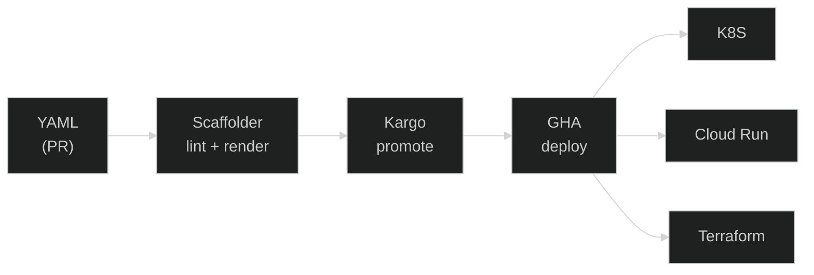
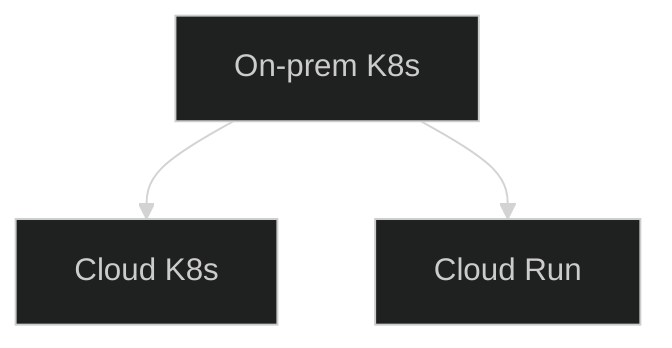
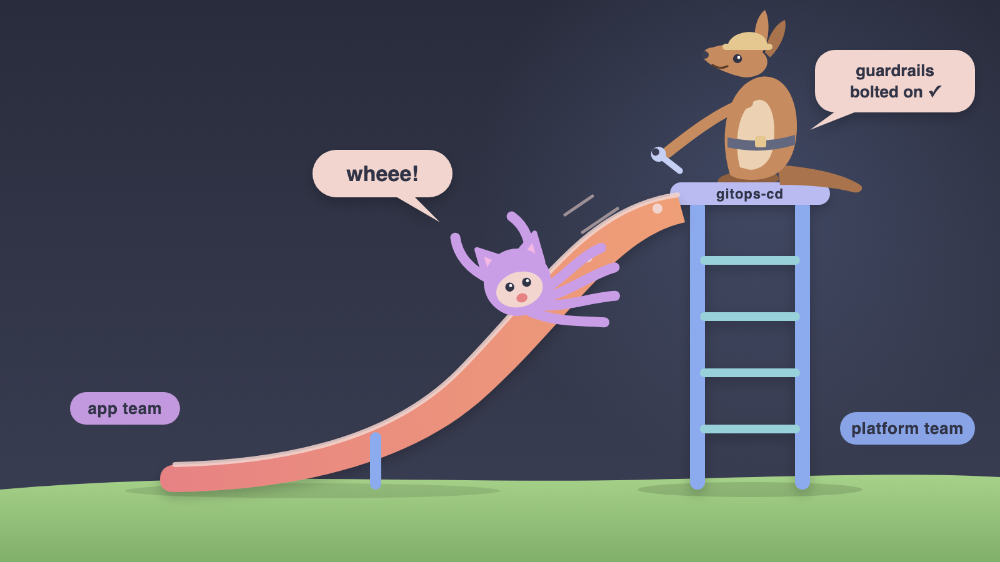

---
theme:
  light: catppuccin-latte
  dark: catppuccin-frappe
  override:
    default:
      alignment: center
    code:
      alignment: center
      minimum_size: 58
      padding:
        horizontal: 2
        vertical: 1
---

<!--
Condensed why.md. Run:
  presenterm -c docs/evaluate/presenterm.yaml docs/evaluate/slides.md
new_lines pads center each slide's content in the config's max_rows: 26 box;
re-measure them after changing a slide's height.
gcd docs skips this deck (presenterm rejects fence
annotations), so snippets aren't lint-checked.
-->

<!-- jump_to_middle -->

Why **Kargo**?
===

<!-- alignment: center -->

_One config model, one promotion flow, every platform_

<!-- end_slide -->

The Problem
===

<!-- new_lines: 5 -->

Teams wiring GHA / Kargo directly, each their own way:

- **Pipelines drift**: every team hand-builds its own
- **Access sprawls**: Kargo RBAC, repo perms, set per tool
- **Policy is optional**: teams can edit or skip checks
- **Errors land late**: at deploy time, not in review
- **One toolchain per platform**: K8S, Cloud Run, Terraform
- **Hard to support**: every setup is a one-off

<!-- end_slide -->

What is **gitops-cd**?
===

<!--
speaker_note: |
  Drift is eliminated, one schema, every app has the same pipeline structure and tools.
  Access is handled by `owners.yaml`, not invisible controls in a UI. We can see who is allowed to do what.
  Policy → platform-owned, teams can't edit it.
  A whole class of errors are eliminated by lint and render tooling.
  Toolchains converge so its easier for the platform team to support application teams.
-->

- Teams (or agents!) write YAML.
- a platform-owned scaffolder lints and renders it.
- Kargo promotes.
- GHA (***Your tool of choice here***) deploys.



<!-- end_slide -->

Compared
===

<!-- new_lines: 4 -->

| | gitops-cd | Kargo alone | GHA alone |
|---|---|---|---|
| Governance | ✓ | ~ | ~ |
| One access file | ✓ | ✗ | ~ |
| Guardrails | ✓ | ✗ | ~ |
| Consistency | ✓ | ✗ | ✗ |
| Full picture | ✓ | ✓ | ✗ |
| Flexibility | ✓ | ~ | ✓ |

✓ built in · ~ partly · ✗ no

<!-- end_slide -->

Governance + Access
===

<!-- new_lines: 2 -->


```yaml
# owners.yaml (excerpt)
codeOwners: [team1]
promoters: {prod: [doug@example.com]}
breakGlass: [grace@example.com]
```

Generates CODEOWNERS + Kargo access, matched on **email**.

- **Pre-deploy checks** before every `prd` deploy
- **No auto-promotion** into prod; replica floors
- **PR only**; UIs read-only (admission policy)
- **Break-glass** approval: named on-call only

(***these are all fully configurable by platform team***)

<!-- end_slide -->

Learn with guardrails
===

Scaffolder CLI: errors say what and where, before review.

```sh
gcd schema app            # every field + rules
gcd lint                  # file:line:col: message
gcd show payments/web -s  # merged config + sources
gcd --root <sandbox> lint # try anything safely
```

(***These checks also run in CI, and comment issues / renderings on the PR***)

<!-- pause -->

```
$ gcd lint payments
apps/web/app.yml:2:1: image: invalid value
  "ghcr.io/example/web:1.2.3" (must match ...)
```

**Agents too**: `system-config` skill edits YAML, then
verifies with `gcd lint` + `gcd show --diff --rendered`

<!-- end_slide -->

One model, every platform
===

<!-- column_layout: [6, 4] -->
<!-- column: 0 -->

```yaml
# apps/web/app.yml
image: ghcr.io/example/web
stages:
  dev:
    targets: {us-east4-dev-k8s: {}}  # K8S
  staging:
    targets: {us-east4-npr-cr: {}}   # Cloud Run
```

```yaml
# apps/infra/app.yml
module: ghcr.io/example/tf-bucket
moduleConstraint: ^1
stages:
  dev:
    targets: {us-east4-dev-tf: {}}   # Terraform
```

<!-- column: 1 -->



<!-- new_lines: 2 -->

- Every field overridable per stage or target
- Terraform: `module:` instead of `image:`
- Migrate one stage at a time, same pipeline

<!-- reset_layout -->

<!-- end_slide -->

Demo
===



<!-- end_slide -->

Trade-offs and future
===

<!-- new_lines: 4 -->

<!-- column_layout: [1, 1] -->
<!-- column: 0 -->

**Trade-offs**

- New field = platform change
- Scaffolder is owned code
- One repo, CODEOWNERS split
- Rendered manifests artifact

<!-- column: 1 -->

**Future**

- Required stage templates
- Team-owned config repos
- Checks per stage / target

<!-- reset_layout -->

<!-- pause -->

**Questions?** Full write-up: `docs/evaluate/why.md`
