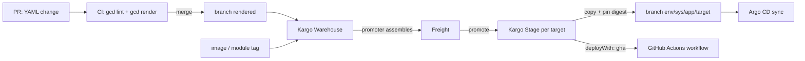

# Concepts

You want to know what the pieces are before you change any YAML.

Terms below are defined precisely in the [glossary](../../GLOSSARY.md); this page shows how they fit.

## What you write

You write plain YAML under `systems/<sys>/`. Nothing else: no Helm, no Kustomize, no Kargo or
Argo CD resources ([ADR 0006](../adr/0006-teams-write-only-yaml.md)). The platform turns your YAML into
everything else.

```text
systems/payments/
  owners.yml                       who reviews, promotes, views
  stages/dev.yml                   pipeline steps, one file per stage
  stages/prod.yml
  targets/us-east4-dev-k8s/        where things run, reusable by every app
    target.yml
    environment-variables/launchdarkly.yml
  apps/web/app.yml                 what ships and where, per stage and target
```

- **System**: one folder under `systems/`, owned by one or more GitHub teams. The folder name is
  its name ([ADR 0007](../adr/0007-systems-and-ownership.md)).
- **Stage**: a step in the system's pipeline (`dev`, `staging`, `prod`). A stage lists the stages it
  `dependsOn`; together they form the promotion graph.
- **Target**: a concrete place to deploy: a cluster and namespace (K8S), a GCP project for Terraform, or a
  Cloud Run region. Targets are shared by every app in the system.
- **App**: something you deploy. Its `app.yml` says what (an `image` or a Terraform `module`) and, per
  stage, which targets it goes to.
- **Deploy**: one app on one target, with every setting merged (app → stage → target, most specific wins).

## How a change reaches a cluster



1. **PR**: CI lints your YAML, renders it, and comments the rendered diff on the PR.
2. **Merge**: CI writes the rendered manifests to the branch `rendered`
   ([ADR 0002](../adr/0002-rendered-manifests-with-kargo.md)). Nothing deploys yet.
3. **Warehouse**: each app has a Kargo Warehouse that watches its rendered folder and its image (or
   module) repository for SemVer tags.
4. **Freight**: a promoter picks a rendered config commit plus an image tag in the Kargo UI. That pair,
   pinned by digest, is a Freight ([ADR 0016](../adr/0016-image-discovery-freight-assembly.md)).
5. **Promote**: each target is a Kargo Stage ([ADR 0012](../adr/0012-kargo-stage-per-target.md)).
   Promoting copies the target's manifests onto its own branch `env/<sys>/<app>/<target>` and pins the
   digest; that target's Argo CD app syncs it. Targets with `deployWith: gha` dispatch a GitHub Actions
   workflow instead.

Freight then moves down your stage graph: once it's verified in `dev`, it can be promoted to stages that
depend on `dev`, by the people allowed to promote there ([promote and access](promote-access.md)).

## Who can do what

All access comes from `owners.yml`, never from UI clicks or identity-provider groups
([ADR 0011](../adr/0011-access-by-email.md)):

- `codeOwners` (GitHub teams) approve PRs that change the system.
- `promoters` (emails, per stage) promote in Kargo.
- `viewers` (emails) see the system's apps in Kargo and Argo CD, read-only.
- `breakGlass` (emails) approve Freight that skipped verification.

## Next

- [Onboard a system](onboard.md)
- [Working loop](workflow.md): the commands you'll use every day
